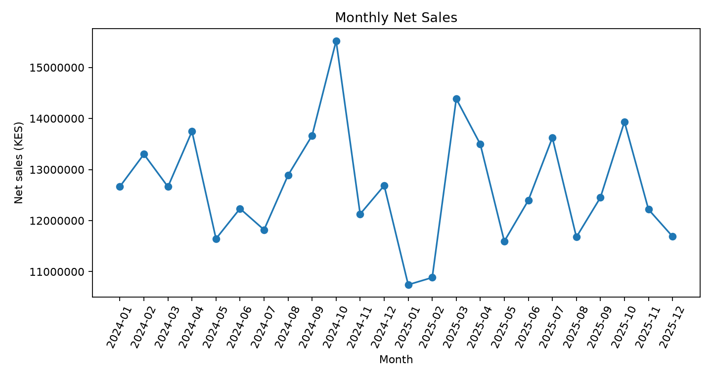

# Felix Kimiri | Junior Data Analyst Portfolio

Development Studies with IT graduate from Tom Mboya University (2025), building practical skills in Python, SQL, data analysis, and visualization through the Power Learn Project.

## About Me

- **Career focus:** Junior Data Analyst
- **Technical skills:** Python, pandas, NumPy, SQL, PostgreSQL, SQLite, Matplotlib
- **Interests:** Business analytics, community development, and NGO programmes
- **GitHub:** https://github.com/kimirifelix-droid
- **LinkedIn:** https://www.linkedin.com/in/felix-kimiri-0306ab268/

## Featured Projects

### Retail Sales Analytics Capstone

Analysed 4,998 retail records.

- Net sales: approximately KES 304.1 million
- Gross profit: approximately KES 78.8 million
- Gross margin: 25.93%
- Eight SQL analyses and three analytical notebooks

[View Capstone Repository](https://github.com/kimirifelix-droid/plp-capstone-a-felix-kimiri)

### PesaPap Growth Analytics

Practised fintech SQL analysis, customer segmentation, cohort analysis, and A/B testing using synthetic data.

[View Project Repository](https://github.com/kimirifelix-droid/plp-da-a7-pesapap-growth-analytics)

### Duka Board Report

Analysed 1,000 retail records from January to June 2026.

[View Project Repository](https://github.com/kimirifelix-droid/plp-da-a6-duka-board-report)

### Student Performance EDA

Explored 1,200 student records.

[View Project Repository](https://github.com/kimirifelix-droid/plp-da-a5-student-performance-eda)

### Mobile Money Agent Data Cleanup

Practised transaction data cleaning and quality checks.

[View Project Repository](https://github.com/kimirifelix-droid/plp-da-a4-agent-data-cleanup)

### Rainfall Advisory Analysis

Used Python and NumPy to clean rainfall data.

[View Project Repository](https://github.com/kimirifelix-droid/plp-da-a2-rainfall-advisory)

## Career Preparation Resources

- [CV](cv/Felix_Kimiri_CV.pdf)
- [Interview preparation](interview_prep.md)
- [Mock interview reflection](mock_interview_reflection.md)
- [LinkedIn post draft](linkedin_capstone_post.md)
- [Monthly sales chart](assets/capstone_monthly_sales.png)

## LinkedIn Capstone Post

**Status:** Draft prepared; publication pending.

[Read the post draft](linkedin_capstone_post.md)

**Published post URL:** To be added after publishing.

## Career Goal

Seeking opportunities to apply data analytics to business, community development, and NGO programmes.

*Figures from generated datasets are illustrative and are not verified real-world business results.*

